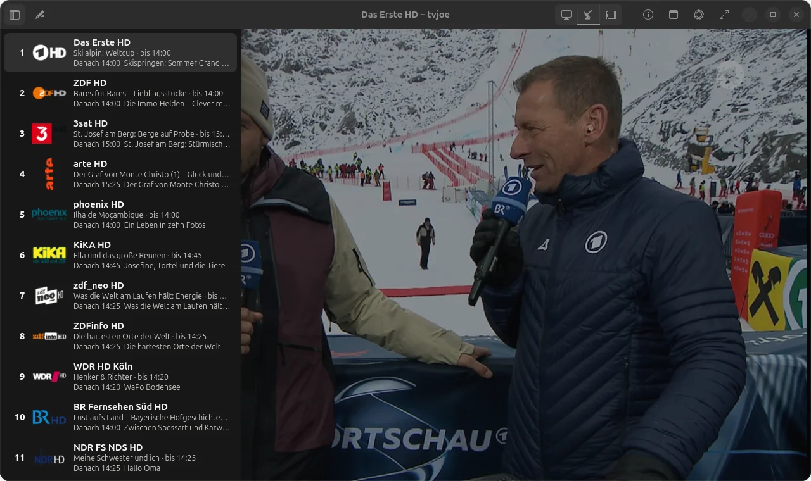
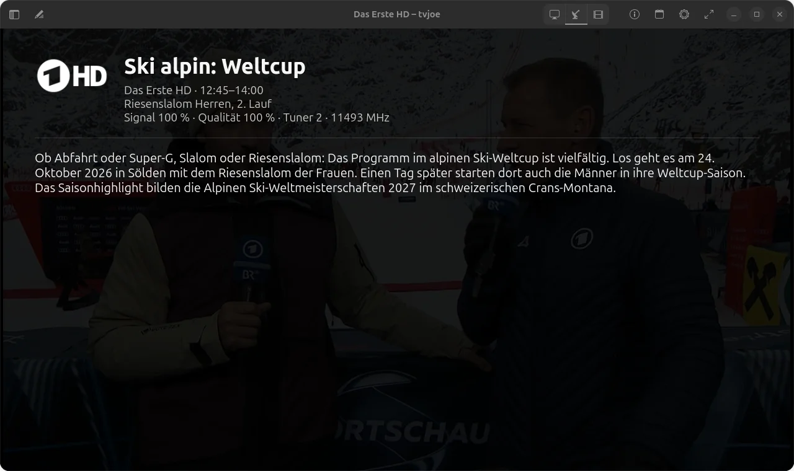
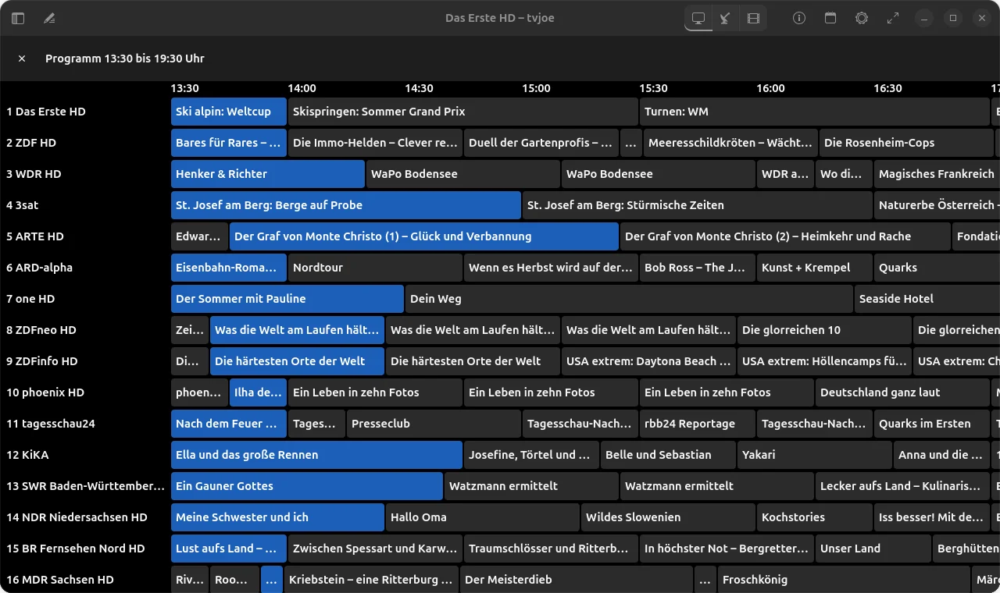
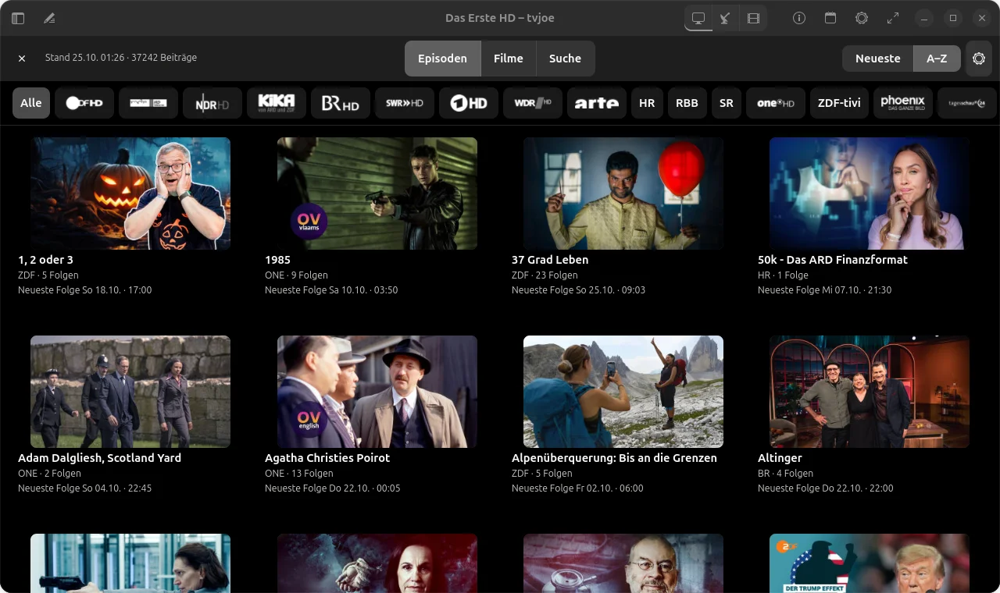
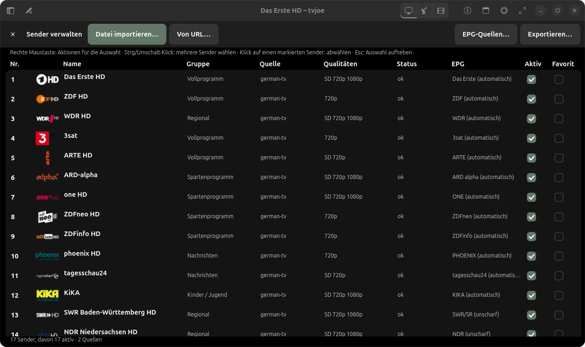

<p align="center">
  
</p>

# tvjoe

**Deutsch** · [English](README.md)

> **Schlanker Streaming-Client für Live-TV unter Linux und Windows.**
> Fernsehen aus eigenen M3U-Listen, Satellit über einen SAT>IP-Empfänger im Heimnetz, die Mediathek
> der öffentlich-rechtlichen Sender und der eigene Jellyfin-Server – in einem Fenster.

<p align="center">
  <a href="https://www.johnlose.de/unterstutzung-fur-john-joe-lose/"></a>
</p>
<p align="center">
  <a href="docs/INSTALLATION.md#installation-windows"></a>
  &nbsp;
  <a href="docs/INSTALLATION.md#installation-ubuntu"></a>
</p>

tvjoe liefert keine Senderlisten mit; die Sender kommen aus eigenen Listen oder vom eigenen
SAT>IP-Empfänger.

- **Schnell und sparsam:** Rust, GTK4/libadwaita und libmpv mit Hardware-Decoding. Live-TV in
  1080p50 braucht gemessen 6–9 % eines Prozessorkerns.
- **Vier Quellen, ein Umschalter:** TV | SAT | Mediathek | Jellyfin in der Kopfleiste. Programm,
  Mediathek und Verwaltung liegen als Ebene über dem Bild, der Ton läuft weiter.
- **Fernsehen wie gewohnt:** Ziffernblock, Senderliste mit laufender Sendung, Einblendung mit
  Jetzt/Danach, Programmraster aus XMLTV.

## Dokumentation

- [`docs/INSTALLATION.md`](docs/INSTALLATION.md) – Installation unter Ubuntu und Windows
- [`docs/ERSTE-SCHRITTE.md`](docs/ERSTE-SCHRITTE.md) – Senderliste übernehmen, Programm eintragen, sortieren, sichern
- [`docs/SAT-IP.md`](docs/SAT-IP.md) – SAT>IP-Empfänger einrichten, Suchlauf, Firewall, unterwegs per WireGuard
- [`docs/ADAPTER.md`](docs/ADAPTER.md) – Empfangsquellen und Adapter: Treiber, mitgelieferte Geräte, eigene Beschreibung anlegen
- [`docs/MEDIATHEK.md`](docs/MEDIATHEK.md) – Mediathek der öffentlich-rechtlichen Sender und Jellyfin
- [`docs/DATENSCHUTZ.md`](docs/DATENSCHUTZ.md) – alle Netzzugriffe
- [`docs/BAUEN.md`](docs/BAUEN.md) – selbst bauen, Kommandozeile
- [`THIRD_PARTY.md`](THIRD_PARTY.md) – verwendete Bibliotheken Dritter mit Lizenzen

> [!WARNING]
> **Privates Hobbyprojekt – nicht gepflegt / unmaintained.**
> Dieses Repository ist für meinen eigenen Gebrauch gedacht und wird nur aus Bequemlichkeit öffentlich bereitgestellt.
>
> * **Keine Unterstützung zugesagt:** Pull Requests werden nicht bearbeitet, Feature-Wünsche nicht zugesagt. Fehler und Wünsche können gemeldet werden (siehe [Fehler melden und Wünsche](#fehler-melden-und-wünsche)) – es kann aber dauern, bis sie bearbeitet werden.
> * **Keine Garantie, Haftung:** Das Programm wird unentgeltlich als Privatprojekt „wie besehen“ bereitgestellt. Es besteht kein Anspruch auf Verfügbarkeit, Fehlerfreiheit, Aktualisierungen oder Support. Für Schäden aus der Nutzung hafte ich nur bei Vorsatz, grober Fahrlässigkeit sowie bei Verletzung von Leben, Körper oder Gesundheit; im Übrigen nur nach den gesetzlichen Vorschriften.
> * **Eigene Umgebung:** Entwickelt und getestet nur auf meinen eigenen Rechnern (Ubuntu 24.04 und 26.04, Windows 10). Die Windows-Fassung ist neu. Auf anderen Systemen kann es fehlschlagen.
> * **Netzwerk:** Das Programm läuft mit den Rechten deines Benutzerkontos und verbindet sich mit den Quellen, die du einträgst. Welche Zugriffe es sonst gibt, steht in [`docs/DATENSCHUTZ.md`](docs/DATENSCHUTZ.md). **Lies den Code, bevor du ihn installierst.**
> * **Keine Updates zugesichert:** Es kann jederzeit ohne Ankündigung Änderungen, Brüche oder die Löschung des Repos geben.
>
> *Private hobby project, unmaintained, provided as-is. No guaranteed support, no warranty.*

<p align="center">
  
  <br>
  <em>Senderliste über dem Bild (L blendet sie ein und aus)</em>
  <br><br>
  
  <br>
  <em>Info über das ganze Bild (Taste I), hier ein SAT-Sender mit Empfangsanzeige</em>
  <br><br>
  
  <br>
  <em>Programmraster (G)</em>
  <br><br>
  
  <br>
  <em>Mediathek der öffentlich-rechtlichen Sender (Filmliste von MediathekView)</em>
</p>

---

## Plattform-Übersicht

| Plattform | Status | Hinweis |
| :--- | :--- | :--- |
| **Linux (Ubuntu 24.04 / 26.04)** | Aktiv | Paket je Ubuntu-Version, Installation per Skript ([Installation](docs/INSTALLATION.md#installation-ubuntu)) |
| **Windows 10/11** | Neu | MSI pro Benutzer ohne Administratorrechte ([Installation](docs/INSTALLATION.md#installation-windows)); OpenGL vom Grafiktreiber nötig |

## Installation

- **Ubuntu 26.04 / 24.04** – [Installation (Ubuntu)](docs/INSTALLATION.md#installation-ubuntu):

  ```bash
  curl -fsSL https://raw.githubusercontent.com/joeMJ/tvjoe/main/install.sh | bash
  ```

- **Windows 10/11:** MSI von der [Release-Seite](https://github.com/joeMJ/tvjoe/releases/latest) –
  [Installation (Windows)](docs/INSTALLATION.md#installation-windows).

> [!IMPORTANT]
> **Windows: vor der ersten Installation das Zertifikat des Herausgebers eintragen.** Die MSI ist mit einem selbst
> ausgestellten Zertifikat signiert; ohne eingetragenes Zertifikat meldet Windows einen „unbekannten Herausgeber“.
> Befehl, Fingerabdruck und Erklärung: [Zertifikat des Herausgebers](docs/INSTALLATION.md#zertifikat-des-herausgebers).

---

## Was das Programm kann

- **Senderliste** mit Nummern, Logos und laufender Sendung; Einblendung beim Umschalten (Nummer,
  Name, Qualität, Jetzt/Danach, bei SAT der Empfang); Info über das ganze Bild (I).
- **Umschalten** per Ziffernblock, Pfeiltasten oder Klick; Qualitätsstufen SD/720p/1080p/UHD mit
  Ausweichen bei Störungen.
- **M3U-Import** aus Datei oder URL mit Vorschau, Prüfung und Erreichbarkeitstest; Teilimport.
- **Senderverwaltung:** Umbenennen, Nummern, Reihenfolge (Ziehen mit Mitlaufen am Rand, an den
  Anfang, ans Ende), Aktiv/Favorit, Export als M3U8. Inaktive Sender zählen bei den Nummern nicht
  mit; neue Sender aus Import oder Suchlauf kommen inaktiv ans Ende und stören die Sortierung nicht.
- **SAT-Quelle** über einen SAT>IP-Empfänger (z. B. EyeTV Netstream 4Sat, Astra 19,2° Ost):
  Prüfen von Gerät und Empfang, Suchlauf in eine eigene SAT-Senderliste, Empfangsanzeige,
  Programm aus dem Signal (EIT) und/oder aus XMLTV – siehe [`docs/SAT-IP.md`](docs/SAT-IP.md).
- **Programmführer** aus XMLTV (auch `.xml.gz`), Programmraster.
- **Mediathek** der öffentlich-rechtlichen Sender: Serien mit Staffeln, Filme, Suche; Fassungen
  zusammengefasst; Weitersehen, nächste Folge automatisch.
- **Jellyfin** als zweite Mediathek: Anmeldung per Quick Connect (ohne Passwort in tvjoe),
  Gesehen-Stand mit Jellyfin abgeglichen, Bandbreitengrenze mit Umrechnung auf dem Server.
- **Zeilensprung entfernen** gegen Kammstreifen bei 576i/1080i (abschaltbar).
- **Logos** für Internet- und SAT-Sender getrennt ein- und ausschaltbar.
- **Sicherung:** Einstellungen und beide Senderlisten in eine Datei exportieren und wieder
  importieren (ohne Jellyfin-Anmeldung).
- **Updateprüfung** über die Releases dieses Repositorys (standardmäßig aus).

<p align="center">
  
  <br>
  <em>Senderverwaltung (Strg+E)</em>
</p>

## Tasten

| Taste | Wirkung |
|---|---|
| Ziffern, Enter | Sender wählen (Pause einstellbar) |
| ← / →, Bild ↑ / ↓ | Sender wechseln |
| ↑ / ↓, + / −, Mausrad | Lautstärke |
| Q | Qualität eine Stufe höher |
| F, Doppelklick / Esc | Vollbild / Vollbild aus |
| M | Ton aus/an |
| L | Senderliste ein/aus |
| I, Esc | Info über das ganze Bild ein / aus |
| A | Tonspur wechseln |
| U | Untertitel wechseln (Spur 1 … letzte, dann aus) |
| Z | Bild füllen / einpassen |
| Leertaste | Fernsehen anhalten / zeitversetzt weiter |
| Bild ↑ / ↓ (zeitversetzt) | 1 Minute zurück / vor |
| Ende | zurück auf live |
| R | laufende Sendung aufnehmen / Aufnahme beenden |
| G | Programmraster |
| Strg+E | Sender verwalten |
| Strg+, | Einstellungen |
| Strg+Q | Beenden |

Beim Abspielen aus der Mediathek oder von Jellyfin:

| Taste | Wirkung |
|---|---|
| Leertaste | Pause / weiter |
| ← / → | 10 Sekunden zurück / vor |
| Bild ↑ / ↓ | 1 Minute zurück / vor |
| Ziffern, Senderliste | zurück zum Fernsehen |

## Datenschutz

tvjoe sendet keine Nutzungsdaten und hat keine Telemetrie. Es verbindet sich mit den Quellen, die
du einträgst; alle Netzzugriffe im Einzelnen: [`docs/DATENSCHUTZ.md`](docs/DATENSCHUTZ.md).

## Mediathek und MediathekView

Die Mediathek nutzt die Filmliste von [MediathekView](https://mediathekview.de/), einem
ehrenamtlichen Projekt, das die Mediatheken der öffentlich-rechtlichen Sender verzeichnet. tvjoe
lädt die Liste höchstens einmal täglich; die Videos kommen direkt von den Sendern.
MediathekView finanziert die Server über Spenden – wer die Mediathek in tvjoe nutzt, kann das
Projekt hier unterstützen: [mediathekview.de/spenden](https://mediathekview.de/spenden/).

## Fehler melden und Wünsche

Am einfachsten über **Einstellungen → Updates → „Fehler melden / Wunsch“**: Das öffnet die
[Issues bei GitHub](https://github.com/joeMJ/tvjoe/issues) im Browser (GitHub-Konto nötig). Es
kann dauern, bis ein Issue bearbeitet wird.

Hilfreich sind:

- Version (**Einstellungen → Updates → Über tvjoe**) und System (z. B. Ubuntu 26.04)
- Quelle (TV, SAT, Mediathek, Jellyfin) und was genau passiert
- Schritte, mit denen sich der Fehler wiederholen lässt, und der Wortlaut einer Meldung

**Nie mitschicken:** den Zugangsschlüssel für Jellyfin (`~/.config/tvjoe/jellyfin.toml`) und
Senderlisten mit Zugangsdaten in den Adressen. Interne Adressen und Namen in Bildschirmfotos bitte
unkenntlich machen.

## Lizenz

Apache-2.0, siehe [LICENSE](LICENSE). Bibliotheken Dritter und ihre Lizenzen:
[THIRD_PARTY.md](THIRD_PARTY.md).

Die Ubuntu-Pakete von libmpv stehen laut deren copyright-Datei unter GPL-3+ (gelinkt gegen
libsmbclient). Für die ausgelieferten tvjoe-Binärpakete gelten diese Bedingungen zusätzlich;
Apache-2.0 ist mit GPL-3 verträglich.
