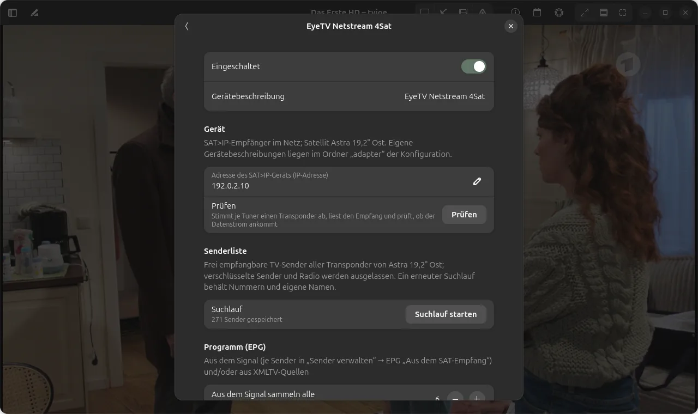

# SAT>IP: Satellit über das Heimnetz

tvjoe kann einen SAT>IP-Empfänger im Heimnetz als eigene Quelle „SAT“ nutzen. Getestet ist die
EyeTV Netstream 4Sat (Firmware 1.1.0) am Satelliten Astra 19,2° Ost. Die SAT-Quelle hat eine
eigene Senderliste neben der TV-Liste aus M3U; umgeschaltet wird mit dem Schüssel-Knopf im
Quellenumschalter der Kopfleiste.

<p align="center">
  
  <br>
  <em>SAT-Quelle: der Knopf mit der Schüssel ist aktiv</em>
</p>

## Einrichten

**Einstellungen → SAT>IP:**

1. **SAT-Quelle verwenden** einschalten.
2. **Adresse des SAT>IP-Geräts** eintragen (IP-Adresse; das Gerät meldet sich nicht von selbst).
3. **Prüfen:** tvjoe stimmt je Tuner einen Transponder ab, zeigt Name, Firmware, Tuner mit Signal
   und Qualität und prüft, ob der Datenstrom ankommt.
4. **Suchlauf starten:** tvjoe liest die Transponderliste aus dem Satelliten und durchsucht alle
   Transponder, mit so vielen Tunern gleichzeitig, wie beim Prüfen Empfang hatten (mit drei Tunern
   gut 2 Minuten). Übernommen werden die frei empfangbaren TV-Sender; verschlüsselte Sender,
   Radio, Platzhalter und Testdienste bleiben weg.

<p align="center">
  IP mit Adresse, Prüfen und Suchlauf" width="760">
  <br>
  <em>Einstellungen → SAT>IP (Beispieladresse)</em>
</p>

Ein erneuter Suchlauf behält Nummern, eigene Namen, Favoriten und den Aktiv-Zustand. Neu
gefundene Sender kommen inaktiv und ohne Nummer ans Ende, nicht mehr gefundene werden als
„fehlt“ markiert. Sortiert wird die SAT-Liste wie die TV-Liste in der Verwaltung (Strg+E bei
laufender SAT-Quelle), siehe [ERSTE-SCHRITTE.md](ERSTE-SCHRITTE.md#senderliste-sortieren).

## Programm, Logos, Empfang

- **Programm:** Die SAT-Sender werden über ihren Namen derselben XMLTV-Quelle zugeordnet wie die
  TV-Sender. Ein eigenes Programm aus dem Satelliten (EIT) liest tvjoe nicht.
- **Logos:** Für SAT-Sender ohne Logo nimmt tvjoe das Logo des gleichen Senders aus der TV-Liste,
  das Senderlogo aus der XMLTV-Quelle oder eines aus der
  [Kodinerds-Logosammlung](https://github.com/jnk22/kodinerds-iptv). Logos lassen sich unter
  **Einstellungen → Senderanzeige** für SAT getrennt abschalten.
- **Empfang:** Die Einblendung zeigt nach dem Umschalten in einer eigenen Zeile Signal und
  Qualität, die Info (Taste I) zusätzlich Tuner und Frequenz.

## Wie die Wiedergabe funktioniert

tvjoe stimmt den Tuner selbst ab (RTSP: SETUP, PLAY), empfängt den Transportstrom per RTP über
UDP und gibt ihn nur auf diesem Rechner (`127.0.0.1`) an den Player weiter. Beim Umschalten und
beim Beenden gibt tvjoe den Tuner wieder frei (TEARDOWN).

## Firewall

Das Gerät schickt den Datenstrom per **UDP** an die Adresse, von der die Anfrage kam. Eine aktive
Firewall muss UDP vom Gerät zulassen, sonst bleibt das Bild schwarz, obwohl Prüfen die Tuner
zeigt (die Abfrage läuft über TCP). tvjoe meldet dann nach einigen Sekunden „Kein Datenstrom vom
SAT>IP-Gerät“.

Unter Ubuntu mit ufw erkennt **Prüfen** den Fall („Kein Datenstrom angekommen“) und bietet
**Freigabe eintragen …** an. Nach Rückfrage trägt tvjoe genau diese Regel ein; das System fragt
nach dem Passwort:

```bash
sudo ufw allow from <Adresse des Geräts> proto udp comment 'SAT>IP'
```

Erlaubt wird nur UDP von diesem einen Gerät. Auf jedem Rechner mit tvjoe ist die Regel einmal nötig.

## Unterwegs per WireGuard

Über einen WireGuard-Tunnel ins Heimnetz geht die SAT-Quelle nur, wenn der Datenstrom den Weg
zurück findet. Die Steuerung (TCP) läuft auch sonst, deshalb zeigt tvjoe dann Empfangswerte, aber
kein Bild.

**Ursache:** Übersetzt der WireGuard-Server die Adressen der Clients ins Heimnetz (Masquerade,
`iptables -t nat … -j MASQUERADE`, bei vielen Vorlagen voreingestellt), sieht das Gerät nur die
Adresse des Servers und schickt den UDP-Strom dorthin. Der Server kennt dafür keine Verbindung und
verwirft ihn. SAT>IP-Geräte senden den Strom oft von einem wechselnden Port; ein Öffnen der
Zuordnung vom Client aus hilft dann nicht.

**Abhilfe ohne Änderung am Router (Proxy-ARP auf dem WireGuard-Server):** Der Client bekommt im
Tunnel eine freie Adresse aus dem Heimnetz (außerhalb des DHCP-Bereichs), und der Server meldet
sich im Heimnetz stellvertretend für diese Adresse. Beispiel mit Heimnetz `192.0.2.0/24`,
Tunnelnetz `10.0.0.0/24`, WireGuard-Server mit Netzschnittstelle `eth0`:

Server (`/etc/wireguard/wg0.conf`):

```ini
[Interface]
Address = 10.0.0.1/24
PostUp = iptables -A FORWARD -i wg0 -j ACCEPT; iptables -A FORWARD -o wg0 -j ACCEPT; iptables -t nat -A POSTROUTING -s 10.0.0.0/24 -o eth0 -j MASQUERADE; sysctl -w net.ipv4.conf.eth0.proxy_arp=1
PostDown = iptables -D FORWARD -i wg0 -j ACCEPT; iptables -D FORWARD -o wg0 -j ACCEPT; iptables -t nat -D POSTROUTING -s 10.0.0.0/24 -o eth0 -j MASQUERADE; sysctl -w net.ipv4.conf.eth0.proxy_arp=0

[Peer]
# Client für SAT>IP unterwegs
PublicKey = <öffentlicher Schlüssel des Clients>
AllowedIPs = 192.0.2.139/32
```

Client:

```ini
[Interface]
Address = 192.0.2.139/32
PrivateKey = <privater Schlüssel des Clients>

[Peer]
PublicKey = <öffentlicher Schlüssel des Servers>
Endpoint = <Adresse des Servers>:51820
AllowedIPs = 192.0.2.0/24
```

Was sich ändert:

- Masquerade gilt nur noch für das Tunnelnetz (`-s 10.0.0.0/24`); Clients mit Heimnetz-Adresse
  erscheinen im Heimnetz mit ihrer eigenen Adresse, und das Gerät schickt den Strom an sie.
- `proxy_arp` lässt den Server auf ARP-Anfragen für diese Adresse antworten und die Pakete in den
  Tunnel weiterleiten. wg-quick legt die Route für `AllowedIPs` selbst an.
- Die Firewall-Regel auf dem Client (UDP vom Gerät) gilt auch im Tunnel.

Mit WGDashboard lässt sich so ein Peer anlegen und die Client-Konfiguration herunterladen; die
Zeilen `PostUp`/`PostDown` stehen in der Konfiguration des Tunnels.
